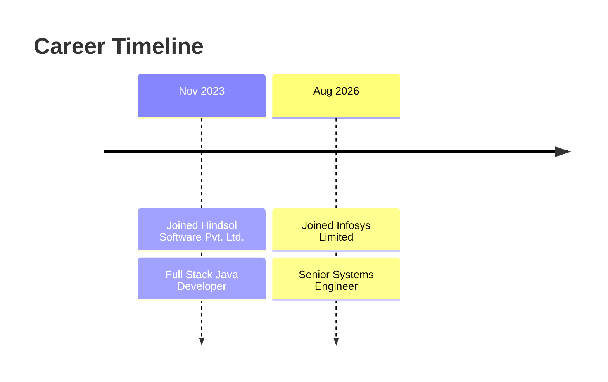

<!-- ===================== HERO ===================== -->

<p align="center">
  
</p>

<p align="center">
  
</p>

<p align="center">
  <a href="https://my-portfolio-five-eosin-43.vercel.app/"></a>
  <a href="https://linkedin.com/in/ravi10299"></a>
  <a href="mailto:ravi.verma10299@gmail.com"></a>
</p>

<p align="center">
  
  
  
</p>

<!-- ===================== ABOUT ===================== -->

<h2 align="center">✨ ABOUT ME</h2>

<p align="center">
  
</p>

<p align="center">
  I'm <b>Ravi Kumar Verma</b>, a <b>Senior Systems Engineer at Infosys Limited</b> with
  <b>3 years</b> of hands-on experience in Java Full Stack development.
  <br><br>
  I design REST APIs, secure applications with Spring Security & OAuth, optimize SQL queries,
  and build responsive interfaces with Angular and React.
</p>

<p align="center">
  
  
  
  
</p>

<table align="center">
<tr>
<td>

```yaml
👨‍💻 role:        Senior Systems Engineer @ Infosys Limited
🏢 previous:     Full Stack Java Developer @ Hindsol Software
🔭 working_on:   Enterprise Java applications
🌱 learning:     System design & advanced DSA
⚡ strengths:    REST APIs, Spring Security, SQL tuning
🎯 goal:         Scalable backend engineering
📫 reach_me:     ravi.verma10299@gmail.com
```

</td>
</tr>
</table>

<!-- ===================== TECH STACK ===================== -->

<h2 align="center">⚡ TECH STACK</h2>

<div align="center">

| | |
|:---:|:---|
| **💻 Backend** |        |
| **🎨 Frontend** |          |
| **🗄️ Database** |   |
| **🛠️ Tools** |        |

</div>

<p align="center">
  
</p>

<!-- ===================== EXPERIENCE ===================== -->

<h2 align="center">💼 PROFESSIONAL JOURNEY</h2>



<details open>
<summary><b>🏢 Infosys Limited — Senior Systems Engineer &nbsp;|&nbsp; Aug 2026 – Present &nbsp;🟢</b></summary>
<br>

- Working as a **Senior Systems Engineer** on Java Full Stack development.
- Building enterprise-grade applications and strengthening problem-solving expertise.

</details>

<details>
<summary><b>🏢 Hindsol Software Pvt. Ltd. — Full Stack Java Developer &nbsp;|&nbsp; Nov 2023 – Jul 2026</b></summary>
<br>

- Developed backend functionality using **Java** and **Spring Boot**.
- Designed and integrated **RESTful APIs**.
- Implemented authentication & authorization with **Spring Security** and **OAuth**.
- Built responsive frontend components using **Angular**.
- Worked with **Hibernate** and **MySQL**.
- Optimized queries using joins, indexing and pagination.
- Tested APIs with **Postman**; used **Git & GitHub** for version control.

</details>

<!-- ===================== PROJECTS ===================== -->

<h2 align="center">🚀 FEATURED PROJECTS</h2>

<table width="100%">
<tr>
<td width="50%" valign="top">

<h3 align="center">🛒 BuyNest</h3>
<p align="center"><b>E-Commerce Application</b></p>

<p align="center">
  
  
  
</p>

- 🛍️ Product browsing
- 🧺 Shopping cart
- 🔐 Authentication workflows
- 📱 Responsive interface

<p align="center">
  <a href="https://github.com/ravi10299/BuyNest"></a>
</p>

</td>
<td width="50%" valign="top">

<h3 align="center">🧾 Store Billing Software</h3>
<p align="center"><b>Billing & Inventory System</b></p>

<p align="center">
  
  
  
</p>

- 📦 Inventory & stock management
- 💳 Billing system
- 🧾 Invoice generation
- 🏷️ Discount management

<p align="center">
  <a href="https://github.com/ravi10299/Store-Billing-Software"></a>
</p>

</td>
</tr>
</table>

<p align="center">
  <a href="https://my-portfolio-five-eosin-43.vercel.app/"></a>
</p>

<!-- ===================== PROBLEM SOLVING ===================== -->

<h2 align="center">🧠 PROBLEM SOLVING</h2>

<p align="center">
  
</p>

<p align="center">
  <sub>Arrays • Strings • Collections • HashMap • Sorting • Searching • Recursion</sub>
</p>

<p align="center">
  <a href="https://leetcode.com/u/YOUR_LEETCODE_USERNAME/"></a>
  <a href="https://www.geeksforgeeks.org/user/YOUR_GFG_USERNAME/"></a>
  <a href="https://www.hackerrank.com/profile/YOUR_HACKERRANK_USERNAME"></a>
</p>

<!-- ===================== ANALYTICS ===================== -->

<h2 align="center">📊 GITHUB ANALYTICS</h2>

<p align="center">
  
  
</p>

<p align="center">
  
</p>

<p align="center">
  
</p>

<h3 align="center">📈 Contribution Activity</h3>

<p align="center">
  
</p>

<p align="center">
  
</p>

<!-- ===================== GOALS ===================== -->

<h2 align="center">🎯 WHAT I'M WORKING TOWARDS</h2>

<p align="center">
  
</p>

<p align="center">
  
</p>

<!-- ===================== CONNECT ===================== -->

<h2 align="center">🤝 LET'S CONNECT</h2>

<p align="center">
  <a href="https://my-portfolio-five-eosin-43.vercel.app/"></a>
  <a href="https://linkedin.com/in/ravi10299"></a>
  <a href="mailto:ravi.verma10299@gmail.com"></a>
</p>

<p align="center">
  
</p>
